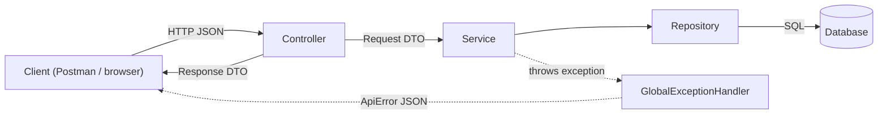

# Library and Skincare API

A Spring Boot 4 REST API demonstrating a production-style controller/service/repository
architecture, request validation, pagination, database migrations, consistent errors,
and integration testing.

## Architecture

Every request flows through the same layers. Errors thrown anywhere are turned into
a consistent JSON response by `GlobalExceptionHandler`.



| Layer | Example | Responsibility |
| --- | --- | --- |
| Controller | `LibraryController` | Receives HTTP requests, reads path/query/body, returns the response. No business logic. |
| Service | `LibraryService` | Business rules (unique ISBN, cannot borrow a borrowed book) inside a `@Transactional` boundary. |
| Repository | `BookRepository` | Database access only (`JdbcTemplate` for books, `JpaRepository` for skincare). |
| Entity | `Book` | Java representation of a database row. |
| DTO | `BookRequest`, `BookResponse` | Shape of the JSON going in and out, separate from the entity. |
| Exceptions | `BookNotFoundException`, `BookUnavailableException` | Named domain errors mapped to HTTP status codes (404 / 400). |

### Package structure

```text
src/main/java/testing_spring/demo
├── DemoApplication.java          # Spring Boot entry point
├── book/                         # Library feature (Spring JDBC)
│   ├── LibraryController.java
│   ├── LibraryService.java
│   ├── BookRepository.java
│   ├── Book.java, BookStatus.java
│   ├── *Exception.java
│   └── dto/request, dto/response
├── skincare/                     # Skincare feature (Spring Data JPA)
│   ├── SkincareProductController.java
│   ├── SkincareProductService.java
│   ├── SkincareProductRepository.java, SkincareCategoryRepository.java
│   ├── SkincareProduct.java, SkincareCategory.java
│   └── dto/request, dto/response
└── common/                       # Shared code
    ├── GlobalExceptionHandler.java
    ├── OpenApiConfig.java
    └── dto/response (ApiError, ApiMessage, PageResponse)

src/main/resources
├── application*.properties       # dev (default) / prod profiles
├── db/migration/                 # Flyway schema migrations
└── dev/db/migration/             # Dev-only seed data
```

### How the controller reads a request

Only the controller layer knows about HTTP. Annotations tell Spring which part of
the request goes into which method parameter:

| Request part | Annotation | Example |
| --- | --- | --- |
| Base URL | `@RequestMapping("/api/books")` | Prefix for every endpoint in the class |
| HTTP method + path | `@GetMapping`, `@PostMapping("/{id}/borrow")` | Chooses which method runs |
| Path value (`/api/books/5`) | `@PathVariable Long id` | `id = 5` |
| Query string (`?keyword=spring`) | `@RequestParam String keyword` | `keyword = "spring"` |
| Paging (`?page=0&size=20&sort=title,asc`) | `Pageable pageable` | Built automatically by Spring |
| JSON body | `@RequestBody BookRequest request` | JSON converted to a Java record |
| Body validation | `@Valid` | Runs the constraints declared on the DTO |

Example: `POST /api/books/5/borrow` with body `{ "borrowerName": "Ada" }`

```java
@PostMapping("/{id}/borrow")                          // matches POST /api/books/{id}/borrow
public BookResponse borrowBook(
        @PathVariable Long id,                        // 5, taken from the URL
        @Valid @RequestBody BorrowBookRequest request // {"borrowerName":"Ada"}, taken from the body
) {
    return BookResponse.from(libraryService.borrowBook(id, request));
}
```

- **Controller**: reads the URL and body, then passes plain Java values to the service.
- **DTO** (`BookRequest`): declares validation rules such as `@NotBlank` and the ISBN
  `@Pattern`. With `@Valid`, Spring checks them before the controller method runs; a
  failure becomes a `400` response through `GlobalExceptionHandler`.
- **Service**: never sees HTTP. It receives `id` and `request` and applies business
  rules, so it can be reused outside the web layer (scheduled jobs, tests).

## Run locally

Requirements: Java 21. The default `dev` profile uses an in-memory H2 database and
loads sample records.

```powershell
.\mvnw.cmd spring-boot:run
```

Open Swagger UI at <http://localhost:8082/docs>. The raw OpenAPI document is at
<http://localhost:8082/api-docs>.

## Example requests

```http
GET /api/books?page=0&size=20&sort=title,asc
GET /api/books?keyword=spring
GET /api/skincare-products?keyword=serum&page=0&size=10
```

```http
POST /api/books
Content-Type: application/json

{
  "title": "Domain-Driven Design",
  "author": "Eric Evans",
  "isbn": "9780321125217",
  "publishedYear": 2003
}
```

```http
POST /api/books/1/borrow
Content-Type: application/json

{ "borrowerName": "Ada Lovelace" }
```

Validation failures have one predictable shape:

```json
{
  "timestamp": "2026-09-06T08:00:00Z",
  "status": 400,
  "error": "Bad Request",
  "message": "Request validation failed",
  "path": "/api/books",
  "fieldErrors": {
    "isbn": "must contain 10 or 13 digits"
  }
}
```

## Production profile

The `prod` profile uses PostgreSQL. Supply the connection through environment
variables instead of committing credentials:

```powershell
$env:SPRING_PROFILES_ACTIVE="prod"
$env:DB_URL="jdbc:postgresql://localhost:5432/demo"
$env:DB_USERNAME="demo"
$env:DB_PASSWORD="change-me"
.\mvnw.cmd spring-boot:run
```

Flyway applies schema migrations from `src/main/resources/db/migration`.

## Test

```powershell
.\mvnw.cmd test
```

The integration suite covers pagination, searching, creation, borrowing, validation,
and deletion.

## Persistence

Books use Spring JDBC (`JdbcTemplate`); skincare products use Spring Data JPA.
Flyway creates both tables and loads sample data in the `dev` profile.
Spring SQL script initialization is disabled so `schema.sql` does not duplicate
the Flyway schema. The development H2 database is in memory, so its data is
reset when the application stops.
